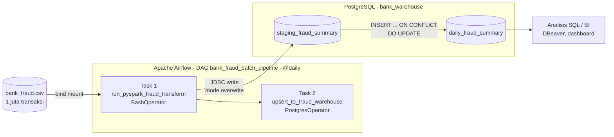
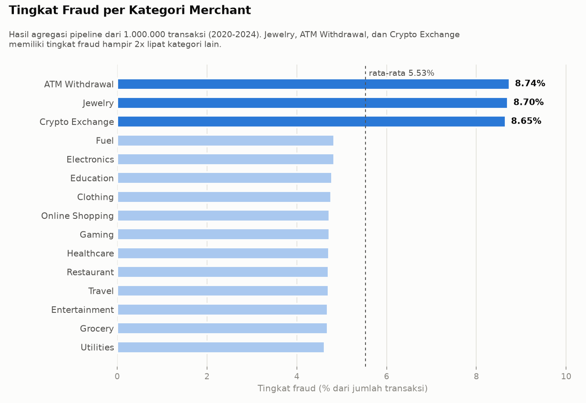

<div align="center">

# Fraud Batch ETL Pipeline

**Pipeline batch ETL terjadwal untuk merekap kasus fraud perbankan harian: Apache Airflow mengorkestrasi transformasi PySpark, lalu hasilnya dimuat ke data warehouse PostgreSQL dengan strategi upsert idempoten.**


</div>

---

## Daftar Isi

- [Gambaran Umum](#gambaran-umum)
- [Arsitektur](#arsitektur)
- [Alur Pipeline](#alur-pipeline)
- [Skema Data Warehouse](#skema-data-warehouse)
- [Hasil](#hasil)
- [Perbaikan yang Dilakukan](#perbaikan-yang-dilakukan)
- [Struktur Folder](#struktur-folder)
- [Cara Menjalankan](#cara-menjalankan)
- [Pengujian](#pengujian)
- [Keterbatasan & Pengembangan](#keterbatasan--pengembangan)

---

## Gambaran Umum

Tim *risk management* sebuah bank membutuhkan rekap harian kasus fraud: berapa transaksi yang terjadi, berapa yang terindikasi penipuan, dan berapa kerugiannya, dipecah per **tanggal**, **kategori merchant**, dan **jenis fraud**. Rekap ini harus diperbarui otomatis setiap hari tanpa menghasilkan data ganda ketika pipeline dijalankan ulang.

| Aspek | Implementasi |
|---|---|
| **Orkestrasi** | Apache Airflow 2.8 (LocalExecutor), jadwal `@daily`, retry otomatis, `catchup=False` |
| **Transformasi** | PySpark: cleansing, kolom turunan, dan agregasi 1 juta baris |
| **Penyimpanan** | PostgreSQL 15 sebagai data warehouse mini, dengan pola *staging table* |
| **Idempotensi** | `INSERT ... ON CONFLICT DO UPDATE` di atas *composite primary key* |
| **Infrastruktur** | Docker Compose: 5 service (2 PostgreSQL, Airflow init, webserver, scheduler) |
| **Kualitas** | Unit test PySpark dengan pytest |

---

## Arsitektur



| Service | Image | Port (host) | Fungsi |
|---|---|:---:|---|
| `target-postgres` | `postgres:15-alpine` | 5433 | Data warehouse tujuan (`bank_warehouse`) |
| `airflow-meta-db` | `postgres:15-alpine` | - | Database metadata internal Airflow |
| `airflow-init` | `iqdamshidqi/airflow-pyspark:2.8.1` | - | Migrasi database Airflow dan pembuatan akun admin (sekali jalan) |
| `airflow-webserver` | `iqdamshidqi/airflow-pyspark:2.8.1` | 8081 | Antarmuka web Airflow |
| `airflow-scheduler` | `iqdamshidqi/airflow-pyspark:2.8.1` | - | Penjadwal dan eksekutor task |

Image Airflow sudah berisi Java 17, PySpark 3.5.0, dan driver PostgreSQL, sehingga tidak perlu proses build.

---

## Alur Pipeline

### Task 1: `run_pyspark_fraud_transform` ([`scripts/spark_fraud_etl.py`](scripts/spark_fraud_etl.py))

| Tahap | Proses |
|---|---|
| **Extract** | Membaca `bank_fraud.csv` (1.000.000 baris, 26 kolom) dengan *schema inference* |
| **Transform** | `transaction_date` menjadi tipe `DATE`; `fraud_type` bernilai `NULL` atau `"None"` diberi label `Legitimate`; kolom baru `fraud_amount` berisi nominal transaksi hanya jika `is_fraud = 1` |
| **Aggregate** | `GROUP BY (transaction_date, merchant_category, fraud_type)` lalu hitung `total_transactions`, `fraud_cases_count`, `total_amount`, dan `fraud_loss_amount` |
| **Load** | Tulis ke `staging_fraud_summary` via JDBC dengan mode `overwrite`, sehingga staging selalu berisi batch terbaru |

### Task 2: `upsert_to_fraud_warehouse` ([`dags/fraud_pipeline_dag.py`](dags/fraud_pipeline_dag.py))

```sql
INSERT INTO daily_fraud_summary (...)
SELECT ... FROM staging_fraud_summary
ON CONFLICT (transaction_date, merchant_category, fraud_type)
DO UPDATE SET
    total_transactions = EXCLUDED.total_transactions,
    fraud_cases_count  = EXCLUDED.fraud_cases_count,
    total_amount       = EXCLUDED.total_amount,
    fraud_loss_amount  = EXCLUDED.fraud_loss_amount;
```

Jika kombinasi kunci sudah ada, baris lama **diperbarui**; jika belum ada, baris baru **ditambahkan**. Karena itu DAG aman dijalankan ulang (*retry*, *backfill*, atau koreksi data) tanpa menghasilkan duplikasi.

---

## Skema Data Warehouse

Tabel `daily_fraud_summary` ([`sql/init_fraud.sql`](sql/init_fraud.sql)) dibuat otomatis saat container `target-postgres` pertama kali menyala:

| Kolom | Tipe | Keterangan |
|---|---|---|
| `transaction_date` | `DATE` | **PK** |
| `merchant_category` | `VARCHAR(100)` | **PK** |
| `fraud_type` | `VARCHAR(100)` | **PK**, berisi jenis fraud atau `Legitimate` |
| `total_transactions` | `INT` | Jumlah transaksi pada grup |
| `fraud_cases_count` | `INT` | Jumlah transaksi fraud |
| `total_amount` | `NUMERIC(15,2)` | Total nominal transaksi |
| `fraud_loss_amount` | `NUMERIC(15,2)` | Total kerugian akibat fraud |

Contoh query analisis tersedia di [`sql/analysis_queries.sql`](sql/analysis_queries.sql).

---

## Hasil

Logika transformasi dijalankan pada dataset lengkap dan hasilnya dicocokkan dengan perhitungan independen menggunakan pandas:

| Pemeriksaan | Hasil |
|---|---|
| Input | 1.000.000 transaksi, periode 1 Jan 2020 - 30 Des 2024 (1.826 hari) |
| Output agregat | **73.776 baris** di `daily_fraud_summary` |
| Kecocokan dengan pandas | **Identik** pada keempat metrik (selisih 0) |
| Keunikan primary key | Tidak ada duplikat kombinasi kunci |
| Konsistensi label | Grup `Legitimate` tidak pernah berisi kasus fraud |
| Idempotensi upsert | Dijalankan 3x tetap 73.776 baris; batch koreksi memperbarui data, bukan menduplikasi |

### Ringkasan bisnis

| Metrik | Nilai |
|---|---:|
| Total transaksi | 1.000.000 |
| Kasus fraud | 55.255 (**5,53%**) |
| Total nominal transaksi | 204,72 juta |
| Total kerugian akibat fraud | 12,60 juta (**6,16%** dari nominal) |



| Kategori merchant | Tingkat fraud | Kerugian | Catatan |
|---|:---:|---:|---|
| **Jewelry** | 8,70% | **4,04 juta** | Tingkat fraud tinggi **dan** nominal besar, menyumbang **32%** total kerugian |
| Electronics | 4,83% | 2,37 juta | Tingkat fraud normal, tetapi nominal transaksi besar |
| Travel | 4,71% | 2,29 juta | Pola serupa Electronics |
| **ATM Withdrawal** | 8,74% | 0,52 juta | Tingkat fraud tertinggi, tetapi nominal per transaksi kecil |
| **Crypto Exchange** | 8,65% | 0,52 juta | Pola serupa ATM Withdrawal |

Enam jenis fraud (Friendly Fraud, Card Cloning, Account Takeover, Synthetic Identity, Phishing, Identity Theft) terdistribusi hampir merata, masing-masing sekitar 9.200 kasus dengan kerugian 2,0-2,2 juta.

**Implikasi:** prioritas pengawasan sebaiknya mempertimbangkan **frekuensi sekaligus nominal**. Jewelry adalah prioritas utama. ATM Withdrawal dan Crypto Exchange sering terkena fraud tetapi dampak finansialnya kecil, sementara Electronics dan Travel jarang terkena fraud tetapi kerugian per kasusnya besar.

---

## Perbaikan yang Dilakukan

| 1 | File inisialisasi skema berada di `sql/init_fraud.sql/init.sql`, sehingga `init_fraud.sql` adalah **folder**. Docker kemudian me-mount folder itu ke `/docker-entrypoint-initdb.d/init.sql`. | PostgreSQL gagal mengeksekusi skrip init, sehingga tabel `daily_fraud_summary` tidak pernah terbentuk dan Task 2 pasti gagal | `init_fraud.sql` dijadikan file SQL biasa sesuai path di `docker-compose.yml` |

Peningkatan tambahan:
- Logika transformasi dipisahkan ke fungsi `transform_fraud_data()` agar bisa diuji tanpa database.
- Path input dan koneksi database dapat diatur lewat environment variable (`FRAUD_INPUT_PATH`, `FRAUD_JDBC_URL`, `FRAUD_DB_USER`, `FRAUD_DB_PASSWORD`), dengan nilai default yang sama seperti sebelumnya.
- Menambahkan unit test, data sampel, contoh query analisis, dan dokumentasi.
- File DAG diganti nama dari `sales_pipeline_dag.py` menjadi `fraud_pipeline_dag.py` agar sesuai isinya.

---

## Struktur Folder

```
fraud-batch-etl-pipeline/
├── dags/
│   └── fraud_pipeline_dag.py      # DAG Airflow: Task 1 (PySpark) >> Task 2 (upsert)
├── scripts/
│   └── spark_fraud_etl.py         # Extract - Transform - Load ke staging (PySpark)
├── sql/
│   ├── init_fraud.sql             # Skema tabel warehouse (auto-init PostgreSQL)
│   └── analysis_queries.sql       # Contoh query analisis
├── data/
│   ├── README.md                  # Keterangan dataset
│   └── sample_bank_fraud.csv      # Sampel 5.000 baris
├── tests/
│   └── test_transform.py          # Unit test transformasi
├── images/
├── docker-compose.yml             # 5 service: 2 PostgreSQL + 3 Airflow
├── requirements-dev.txt
└── LICENSE
```

---

## Cara Menjalankan

**Prasyarat:** Docker Desktop (RAM minimal 4 GB untuk Docker) dan dataset `bank_fraud.csv` di folder `data/`.

```bash
# 1. Clone repository
git clone https://github.com/r4dtwhle/fraud-batch-etl-pipeline.git
cd fraud-batch-etl-pipeline

# 2. Letakkan dataset di data/bank_fraud.csv

# 3. Jalankan seluruh service
docker compose up -d

# 4. Pantau hingga airflow-init selesai dan webserver aktif
docker compose ps
```

1. Buka **http://localhost:8081** dan login dengan `admin` / `admin`.
2. Aktifkan DAG **`bank_fraud_batch_pipeline`**, lalu klik **Trigger DAG**.
3. Setelah kedua task berstatus *success*, cek hasilnya di DBeaver atau psql pada `localhost:5433` (database `bank_warehouse`, user `de_user`).

```bash
docker exec -it target-postgres psql -U de_user -d bank_warehouse \
  -c "SELECT COUNT(*), SUM(total_transactions) FROM daily_fraud_summary;"
```

> **Pernah menjalankan versi lama?** Skrip inisialisasi PostgreSQL hanya dieksekusi pada volume yang masih kosong. Hapus volume lama terlebih dahulu dengan `docker compose down -v`, lalu jalankan `docker compose up -d` lagi.

> Kredensial di `docker-compose.yml` (`de_user` / `password123`, `admin` / `admin`) hanya untuk lingkungan lokal. Gunakan *secret* atau file `.env` bila di-deploy ke server.

---

## Pengujian

Unit test memverifikasi logika transformasi PySpark tanpa membutuhkan Docker maupun database:

```bash
pip install -r requirements-dev.txt     # membutuhkan Java 17+
pytest -v
```

| Test | Yang diuji |
|---|---|
| `test_none_fraud_type_becomes_legitimate` | `NULL` dan `"None"` diberi label `Legitimate` |
| `test_fraud_loss_only_counts_fraudulent_transactions` | Kerugian hanya dihitung dari transaksi `is_fraud = 1` |
| `test_grouping_keys_are_unique` | Kombinasi kunci agregasi selalu unik (syarat upsert) |
| `test_sample_csv_totals_are_preserved` | Total transaksi dan kasus fraud pada data sampel tidak berubah setelah agregasi |

---

## Keterbatasan & Pengembangan

- **Full reload:** setiap run memproses seluruh dataset. Untuk data yang terus bertambah, pipeline sebaiknya **incremental** dengan memfilter berdasarkan `{{ ds }}` (tanggal eksekusi Airflow).
- **Data quality check** dapat ditambahkan sebagai task terpisah, misalnya validasi jumlah baris atau nilai negatif (Great Expectations atau `SQLCheckOperator`).
- **Penyimpanan staging** bisa memakai format Parquet di *object storage* agar lebih skalabel.
- **Dashboard** (Streamlit atau Metabase) di atas tabel `daily_fraud_summary` untuk pemantauan harian.

---

<div align="center">
<sub>Dibuat oleh <a href="https://github.com/r4dtwhle">r4dtwhle</a> · Dikembangkan dari modul praktikum Analisis Big Data · Lisensi MIT</sub>
</div>
